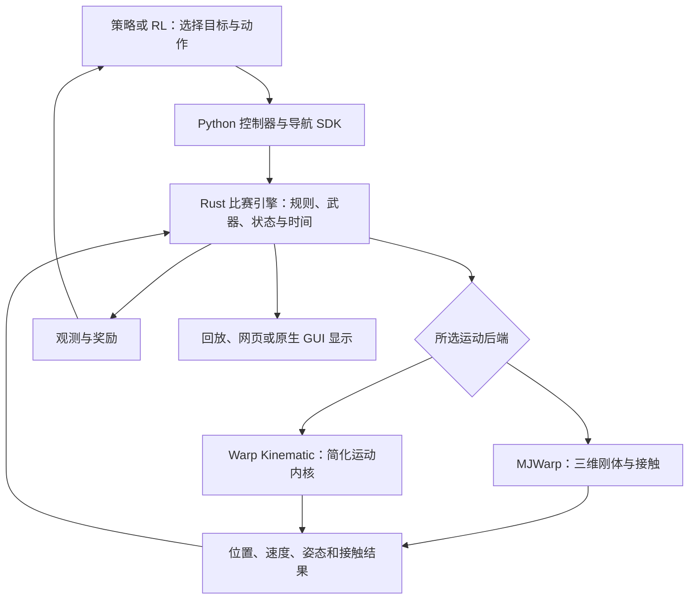
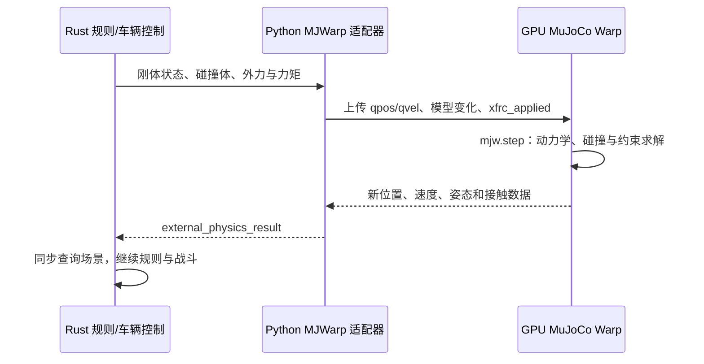

# RMUC 2027：MJWarp 与 Warp Kinematic 仿真原理

本文按 2026-11-09 的本地源码说明实际实现。重点区分比赛规则、机器人运动、强化学习、导航和画面显示，避免把“使用 GPU”理解为整场比赛的所有计算都在 GPU 上。

## 1. 两个后端分别用什么引擎

| 层次 | `mjwarp` | `warp_kinematic` |
| --- | --- | --- |
| 比赛规则 | 项目自己的 Rust 比赛引擎 | 同一套 Rust 比赛引擎 |
| 运动与接触 | MuJoCo Warp，通过 NVIDIA Warp 在 GPU 上执行刚体与接触求解 | 项目自己编写的 NVIDIA Warp 内核 |
| 机器人模型 | 自由刚体、复合碰撞体、质量与惯量、外力和力矩 | 平面移动、朝向、高度包络、简化接触、通行状态机 |
| CPU 几何与规则查询 | 保留 Rapier 场景及查询镜像 | 保留 Rapier 场景及查询镜像 |
| 策略与导航 | Python 策略和公共 SDK | 同一层策略和 SDK |
| 强化学习 | Python Gym 接口、Stable-Baselines3 PPO、PyTorch | 同一套训练接口，可选择此后端 |
| 画面 | 独立的显示层 | 独立的显示层 |

**`warp_kinematic` 不是给 MuJoCo 调低精度，而是换了一套运动模型。** 它没有调用 `mujoco_warp.step()` 来计算机器人移动。

NVIDIA Warp 是能把带类型的 Python 内核编译为 CPU/GPU 代码的计算框架；MuJoCo Warp 是建立在它之上的 GPU 物理模拟实现。项目也可以直接使用 Warp，自己定义运动规律。[NVIDIA Warp 官方仓库](https://github.com/NVIDIA/warp)、[MuJoCo Warp 官方仓库](https://github.com/google-deepmind/mujoco_warp)

项目还保留第三种 `rapier` 后端：直接由原有 CPU Rapier 完成运动积分。Rust 依赖为 `rapier3d-f64 = 0.26.1`。使用另外两个后端时，不能理解为 Rapier 和 MuJoCo 同时各自推进一次机器人运动；运动权交给所选后端，规则与几何查询仍由原引擎管理。[Rapier 官方介绍](https://rapier.rs/)

## 2. 共用的比赛系统怎样工作



共同保留的主要内容包括机器人和建筑血量、弹药、热量、射击、命中判定、死亡复活、控制点、经济、装配、胜负和比赛时间。GPU 后端主要替换机器人运动的计算，不会自动接管这些规则。

Python 的 `Match` 启动 Rust 程序 `rmuc-sim`，通过标准输入输出交换 JSON 行。规则引擎需要外部运动结果时，Python 适配器把请求交给 GPU，再把结果交回 Rust。因此当前实现是 **CPU 规则 + GPU 运动 + CPU 策略调度** 的混合系统。

### 时间层级

默认文件 `configs/rl/sentry-mjwarp-hour.json` 当前使用以下设置：

| 环节 | 频率/时长 | 含义 |
| --- | --- | --- |
| RL 选择新目标 | 2 Hz，间隔 0.5 仿真秒 | `rl_seconds = 0.5` |
| 学习控制器更新执行动作 | 2 Hz | `learning_control_hz = 2` |
| 其他固定策略 | 默认 10 Hz | 未配置 `fixed_policy_hz` 时的默认值 |
| 对外比赛帧 | 20 Hz，间隔 0.05 秒 | 一次比赛 `step()` |
| 物理/战斗子步 | 120 Hz，间隔约 0.008333 秒 | 每个比赛帧有 6 个子步 |

因此当前配置不是“所有机器人所有逻辑都只有 2 Hz”。学习机器人按 2 Hz 更新控制，NPC 固定策略默认仍按 10 Hz 调用；规则和运动继续细分推进。

一个 RL 环境步推进 0.5 仿真秒，即 10 个比赛帧、60 个物理子步。完整 420 秒约为每环境 840 个 RL 步；提前终止、截断或重置会影响实际记录。两环境同时各走一步，会产生两条训练样本，不能把“样本总数”和“单场比赛走过多少秒”混为一谈。

## 3. MJWarp：实际的三维刚体运动

### 3.1 从原比赛场景生成 MuJoCo 模型

入口为 `rl/mjwarp/arena.py` 的 `ArenaPhysics`。它接收 Rust 导出的刚体、碰撞体、质量、惯量、位置、速度、外力和力矩，转换成 MuJoCo 的 MJCF XML。

转换包括：

- 动态刚体使用 `freejoint`，允许三维平移和三维转动。
- 质量、质心、主惯量及其坐标系由原场景导入。
- 箱体、球、胶囊、圆柱等转换为 MuJoCo 对应几何；坐标轴和四元数按两端约定转换。
- 复合碰撞体递归展开；圆角箱体使用多个基础几何近似表达。
- 地形网格按可碰撞表面分解为凸三角柱等几何，避免把凹地形整体当成一个凸包。
- 折叠、机械臂运动、复活等造成的碰撞体和质量变化，会同步到模型。

这里导入的是**碰撞与动力学模型**，不是把网页里漂亮的 GLB 视觉模型直接拿来求解。视觉模型的面数与实际碰撞几何数量是两回事。

当前生成的模型设置包含重力 `-9.81 m/s²`、Euler 积分器、Newton 求解器以及 20 次求解迭代。它们是此项目代码中的选择，不代表所有 MuJoCo 应用都使用这些设置。

### 3.2 GPU 中怎样建立世界

`rl/mjwarp/runtime.py` 的 `BatchPhysics` 执行：

```python
cpu_model = mujoco.MjModel.from_xml_string(xml)
model = mujoco_warp.put_model(cpu_model)
data = mujoco_warp.make_data(cpu_model, nworld=num_worlds, ...)
```

`model` 保存模型参数，`data` 保存各个世界的位置、速度、接触和求解状态。多个世界可以使用同一模型拓扑并行运行，但相互不发生碰撞。

批处理服务会把兼容请求组合起来。碰撞掩码和拓扑变化可能使请求分组或触发重建；不是任意不同的模型都可以不加处理地塞进同一个批次。

### 3.3 每个物理子步的数据流



具体而言，`prepare()` 填充位置 `qpos`、速度 `qvel`、外部空间力 `xfrc_applied` 等数组；`runtime.step()` 执行 `mujoco_warp.step()`。CUDA 路径会捕获并重用计算图，然后同步设备，检查接触/约束容量。

之后回读位置和速度，通过接触几何与世界编号筛选接触冲量，最后按原刚体 ID 返回结果。CPU 查询场景使用这些新姿态进行后续规则判定。

### 3.4 它能表达什么，仍然简化了什么

它可以产生车体俯仰、横滚、碰撞后的旋转、落地冲击、倾覆等三维刚体现象。

但目前不是每个轮子、每段腿和电机都建立成完整的 MuJoCo 关节机器人。原车辆控制、虚拟悬挂等逻辑仍会在 CPU 端计算力和力矩，再交给 GPU 积分。使用 MuJoCo Warp 不等于已经具备真实机器人所有机械细节，也不能直接把结果视作现实真值。

### 3.5 为什么 GPU 开着仍可能慢

当前外部物理协议需要按 120 Hz 子步往返。每次还可能包含场景参数更新、数组准备、CPU→GPU 上传、核函数启动、同步、GPU→CPU 回读和 JSON 编解码。

世界数量较小时，GPU 计算量可能不足以摊薄这些固定成本；碰撞几何分解又会增加接触求解工作。因此“显卡可用”和“整套系统一定比原 CPU 仿真快”是两个问题。

## 4. Warp Kinematic：项目自己写的 GPU 简化运动模型

### 4.1 保存什么状态

它主要保存平面位置和速度、朝向、折叠进度、离地/地面高度、车体高度包络、跳跃状态和机器人参数。底层主要使用 FP32 的 Warp 数组，并按世界批量组织机器人。

可以把主体理解为：**平面上的机器人占用一个具有高度范围的移动包络，再叠加地形高度和专门的通行动作。** 这比完整六自由度刚体系统少求解很多状态和约束。

### 4.2 一次比赛帧的流程

与 MJWarp 每子步交换不同，简化版的 `kinematic_frame` 协议一次提交 0.05 秒的运动请求，在 GPU 上连续完成 6 个 1/120 秒子步，再返回 6 份运动样本。

每个子步主要执行：

1. 根据动作更新转向、折叠和腿部伸展状态。
2. 检查是否进入允许跳跃的入口与朝向。
3. 根据目标运动、加速度、驱动力、功率、抓地和阻力更新平面速度。
4. 对障碍物执行扫掠，限制穿墙。
5. 检查地形高度变化，限制无法通过的台阶。
6. 解算机器人之间的简化连续接触。
7. 更新跳跃或下落状态，记录本子步的位置、速度和接地状态。

Rust 随后逐个应用这 6 个样本，继续推进对应的战斗规则。若中途死亡或断电，后续预计算运动需要服从权威规则状态，不能继续无条件前进。

### 4.3 移动不是直接瞬移

`motion.py` 的 `integrate` 会限制加速、驱动力和功率，并考虑滚动阻力、空气阻力、制动与滑行。轮腿模型还限制侧向驱动，不能像全向底盘那样任意横移。

概念上是根据指令求目标速度，再按允许的力与加速度更新：

```text
目标速度 = 归一化移动指令 × 允许速度
新速度   = 旧速度 + 受驱动力、抓地、功率等限制的速度变化
新位置   = 旧位置 + 新速度 × 子步时间
```

这是解释模型的简化公式，实际实现还包含不同底盘分支、阻力、接触和通行约束。

### 4.4 地形怎样处理

`terrain.py` 通过地图参数和解析高度函数计算坡面、起伏路段、平台和倒角；不会逐帧遍历视觉模型的所有三角形。

运动扫掠会检查地形高度与可通过条件。只有能保守证明安全的平滑路段才使用快速路径，否则继续采样检查。车体和墙体的高度范围也参与通行判定，因此折叠降低高度后才可能通过低洞口。

这不是“任何位置都自动贴地通过”。地图通行能力和入口限制仍然存在。

### 4.5 机器人之间怎样碰撞

`contacts.py` 使用平面圆形占用与连续碰撞时间检测，按质量进行零恢复系数的法向冲量处理，允许切向运动。接触推动后还需要重新检查墙体和地形。

主要移动核函数按机器人并行；接触求解由每个世界的线程处理该世界机器人，避免多个线程同时修改同一辆车。不同世界之间不发生碰撞。

这能处理挡路、挤压和简单避让，但不表达真实装甲、轮胎、腿部之间所有形状的互锁与三维翻滚。

### 4.6 跳跃怎样实现

`traversal.py` 对地图指定入口、目标落点和具备能力的机器人使用显式跳跃状态机。触发前检查位置、朝向、冷却、落点占用与路径障碍。

成功触发后，位置沿插值轨迹运动，额外高度采用：

```text
p(s) = 起点 + (终点 - 起点) × s
z(s) = p(s).z + 4 × 0.8 × s × (1 - s)
0 ≤ s ≤ 1
```

其中 0.8 米是相对起终点插值线的拱高参数；持续时间按距离与速度估计，并限制在 0.7～1.4 秒。当前实现针对指定地图跳跃连接，不是任意台阶通用的腿部控制器。

路径受阻时会中止水平通过并进入下落处理，不会保证自动到达落点。**这条跳跃轨迹不是由电机扭矩、腿部关节动力学和接触自然求出来的。**

### 4.7 悬挂、姿态与摔倒的处理

`pose.py` 使用准静态支撑高度，结合重量、刚度、机械限位和伸展速度近似车身高度，不求解真实悬挂振荡。

Rust 的 `physics_kinematic.rs` 应用样本时仅设置朝向旋转，并明确写入：

```rust
r.upright = 1.0;
r.tipped = false;
r.self_righting = false;
```

因此这个后端不会通过完整动力学产生俯仰、横滚或真实倾覆。它仍有运动、碰撞、下落与高度限制，但无法用来验证防摔、落地姿态控制和真实轮腿稳定性。

## 5. 自写 Warp 内核具体是什么意思

项目用 `@wp.kernel` 定义批量计算入口，用 `@wp.func` 定义供内核调用的函数，用 `wp.array` 保存状态，通过 `wp.launch(..., device="cuda:0")` 执行。

例如下面仅演示编程模式，不是项目实际运动求解器：

```python
import warp as wp

@wp.kernel
def move_example(position: wp.array(dtype=wp.vec2),
                 velocity: wp.array(dtype=wp.vec2), dt: float):
    i = wp.tid()
    position[i] = position[i] + velocity[i] * dt

# position 和 velocity 是预先建立的设备数组。
# wp.launch(move_example, dim=count,
#           inputs=[position, velocity, 1.0 / 120.0], device="cuda:0")
```

Warp 编译并执行这些数值运算；至于碰到墙要怎样停、跳跃怎样走、重量怎样影响碰撞，均由项目自己的函数定义。Warp 不会自动赋予这个内核完整的 MuJoCo 物理行为。

## 6. RL、导航和开火分别由谁负责

当前 RL 动作为两个归一化坐标，范围为 `[-1, 1]`。`portable.py` 将它们映射成地图目标点，蓝方再做阵营坐标镜像。目标点经过合法性与可达性处理，再交给导航 SDK 执行。

所以学习的是“去哪里”等高层选择，不是直接学习轮子电压、关节扭矩或跳跃时每条腿怎样发力。

公共导航结合地图路点图、反向 Dijkstra 路径代价与局部通行检查，并通过底盘能力状态机处理接近、对齐、折叠、过洞、跳跃和落地。不同配置中的 `navigation_mode` 和策略入口会影响实际使用的执行分支；不能把所有行为都归因于一个 GPU 核函数。

目前 `execute_goal()` 还会使用固定规则处理低血量回补、复活、武器、补弹及哨兵姿态。开火来自基线武器模块，并有按动作保持时间检查的安全限制。它不是 PPO 同时输出瞄准角、扳机和底盘目标的端到端控制。

PyTorch 的 `--device cuda` 决定策略网络在哪计算；配置里的 `sim_device = "cuda:0"` 决定运动后端在哪计算。两者相关但独立。网络放在 GPU 上，不代表规则、导航、JSON 传输和全部奖励计算也都转到了 GPU。

### 一个容易误判的例子：上台阶后不动

此前默认配置 seed 42 的 MJWarp 记录中，蓝 3 到达中央防守目标附近后，策略主动给出零移动；目标距离已小于该策略 0.35 米的停车阈值。被推离目标或进入低血量回补后，它又会继续移动。

这次现象是防守策略停车，不是 GPU 冻结。诊断类似问题需要同时记录目标点、实际坐标、移动命令、接地/姿态和血量，区分“策略要求停”和“有移动命令但物理走不动”。这次结论不能推广为所有停车问题都正常。

## 7. GUI 与仿真引擎是什么关系

### 原生 MJWarp GUI

当前 `rl/mjwarp/viewer.py` 使用 `mujoco.viewer.launch_passive()` 创建 Ubuntu 原生窗口，将 GPU 计算后的状态同步给显示端，并叠加阵营和血量文字。

在 Ubuntu 桌面终端运行：

```bash
cd ~/rmuc2027
research/.venv/bin/python -m rmuc2027_research.rl.mjwarp.viewer \
  --config configs/rl/sentry-mjwarp-hour.json \
  --device cuda:0 --seed 42 --duration 420 --speed 1
```

此入口明确选择 `physics_backend='mjwarp'`。默认观看固定策略对局；可以用 `--red`、`--blue` 选择其他策略，也可以用 `--rl-model 检查点.zip --rl-team red` 只让红方 7 号哨兵运行冻结 RL，其余机器人仍执行固定策略。RL 本方的其他机器人沿用训练时的队伍，对手可另选。模型会临时导出，窗口关闭后清理；不会启动训练。完整命令见 [研究工具说明](research.md#mjwarp-完整-5v5-哨兵训练场景)。

即使传入其他后端的训练配置，原生窗口仍显示完整 MJWarp，而非 `warp_kinematic`；跨后端观看需要另行判断策略迁移效果。`--speed 1` 是显示节奏目标，计算不够快时不能保证实时。

### Arena 网页界面

原 Arena 风格界面是另一层显示系统，使用比赛帧呈现场景、HUD 与机器人状态。网页表现漂亮与否，不决定底层用了什么运动后端；无界面训练也可以正常运行。

简化后端当前没有与上述原生 MJWarp viewer 等同的专用入口。训练策略导出、网页执行和结果一致性也需要单独验证，不能因为存在导出接口就宣称已完成训练效果验收。

## 8. 为什么简化版快，代价是什么

| 项目 | MJWarp | Warp Kinematic |
| --- | --- | --- |
| 主要运动状态 | 三维位置与姿态、线速度与角速度 | 平面运动、朝向和独立高度状态 |
| 接触求解 | 刚体接触与约束 | 简化扫掠和质量相关的平面接触 |
| 车体翻滚 | 可以发生 | 不求解，保持直立 |
| 跳跃 | 外力、车体动力学与接触共同决定 | 指定通行连接上的显式轨迹 |
| 悬挂 | 原控制逻辑计算支撑等力，GPU 积分 | 准静态高度近似 |
| CPU/GPU 交换粒度 | 每个 120 Hz 子步 | 每个 20 Hz 比赛帧，内部 6 子步 |
| 更适合验证 | 接触、倾覆、落地及三维运动问题 | 战术目标、通行选择和较快采样 |
| 不能保证 | 与现实机器人完全一致 | 与完整刚体后端轨迹一致 |

简化版加速来自减少求解状态、避免通用三维约束求解、解析地形、合并子步通信和重用设备状态，不能只归因于“3D 表面变简单”。关闭渲染也不会自动消除 CPU 规则与运动协议的成本。

两个后端也不保证逐步相同的轨迹。即使规则相同，接触、跳跃与高度模型不同，也会改变到达时间、交火位置、掩体关系和训练分布。简化后端训练出的策略应在目标部署后端复核关键通行与对战表现。

## 9. 当前速度记录应该怎样读

最近已记录的一次简化后端采样：两个环境各推进 420 仿真秒，采样墙钟约 95.455 秒。

```text
单环境推进倍率 = 420 / 95.455 ≈ 4.40 倍实时
总采样吞吐     = 2 × 420 / 95.455 ≈ 8.80 仿真秒/现实秒
```

这个数字来自采样测试，不含完整 PPO 更新，初始化和预热另计，不能直接宣称“含训练优化的全流程也是 4.40 倍”。来源为 [采样验证记录](validation/terrain-edge-sampler-20261109.json)。

完整 MJWarp 的 GUI 或轨迹诊断有显示、记录等额外开销，也不能拿一次短诊断的墙钟时间代替正式整场性能测量。

本文仅核对源码并解释架构，没有重新启动训练或性能优化。工作区还存在暂停中的主机上传缓冲复用改动，其完整回归尚未完成；上面的性能记录不代表这些新改动已通过验证。

## 10. 对照源码阅读

以下路径相对于本文所在的 `docs/` 目录。

| 想了解的部分 | 文件与入口 |
| --- | --- |
| 后端选择和固定策略调度 | [battle.py](../research/rmuc2027_research/strategies/battle.py)：`Battle` |
| Python 与 Rust 通信 | [engine.py](../packages/core/rmuc2027_core/engine.py)：`Match` |
| 规则与子步循环 | [lib.rs](../packages/simulation/src/lib.rs) |
| 原 CPU 物理与车辆控制 | [physics.rs](../packages/simulation/src/physics.rs) |
| 外部刚体协议 | [physics_external.rs](../packages/simulation/src/physics_external.rs) |
| 简化运动样本应用 | [physics_kinematic.rs](../packages/simulation/src/physics_kinematic.rs) |
| MJCF 转换、状态上传与回读 | [mjwarp/arena.py](../research/rmuc2027_research/rl/mjwarp/arena.py)：`ArenaPhysics` |
| GPU 模型和求解生命周期 | [mjwarp/runtime.py](../research/rmuc2027_research/rl/mjwarp/runtime.py)：`BatchPhysics` |
| MJWarp 批处理 | [mjwarp/batching.py](../research/rmuc2027_research/rl/mjwarp/batching.py) |
| 原生窗口 | [mjwarp/viewer.py](../research/rmuc2027_research/rl/mjwarp/viewer.py) |
| 简化帧内核调度 | [warp_kinematic/arena.py](../research/rmuc2027_research/rl/warp_kinematic/arena.py)：`step_frame`、`_simulate` |
| 平面运动积分 | [warp_kinematic/motion.py](../research/rmuc2027_research/rl/warp_kinematic/motion.py)：`integrate`、`MotionBatch` |
| 地形高度与通行检查 | [warp_kinematic/terrain.py](../research/rmuc2027_research/rl/warp_kinematic/terrain.py) |
| 机器人接触 | [warp_kinematic/contacts.py](../research/rmuc2027_research/rl/warp_kinematic/contacts.py)：`resolve` |
| 指定连接跳跃 | [warp_kinematic/traversal.py](../research/rmuc2027_research/rl/warp_kinematic/traversal.py) |
| 准静态支撑高度 | [warp_kinematic/pose.py](../research/rmuc2027_research/rl/warp_kinematic/pose.py) |
| 简化运动协议 | [warp_kinematic/protocol.py](../research/rmuc2027_research/rl/warp_kinematic/protocol.py) |
| 导航和能力状态机 | [sdk.py](../packages/core/rmuc2027_core/sdk.py) |
| RL 环境和配置默认值 | [session.py](../research/rmuc2027_research/rl/session.py) |
| RL 目标映射和固定执行规则 | [portable.py](../research/rmuc2027_research/rl/portable.py) |
| PPO 训练 | [learning.py](../research/rmuc2027_research/rl/learning.py) |
| 当前默认配置 | [sentry-mjwarp-hour.json](../configs/rl/sentry-mjwarp-hour.json) |

官方资料用于说明框架性质；上面的项目行为以链接的本地源码为依据。修改后端实现后，应同步修订本文中的频率、近似边界和命令说明。
